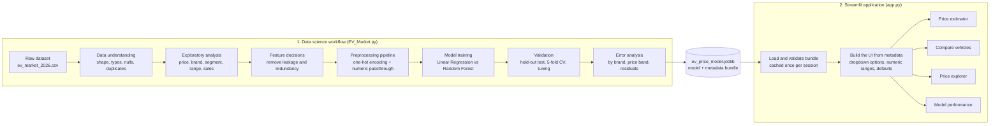
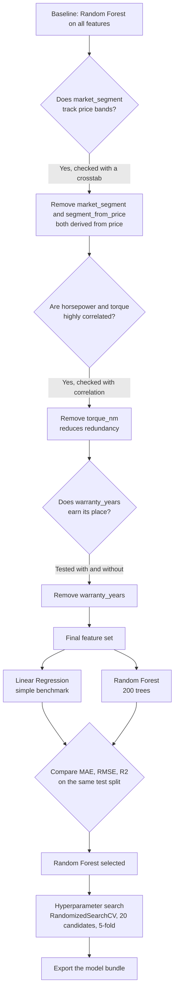
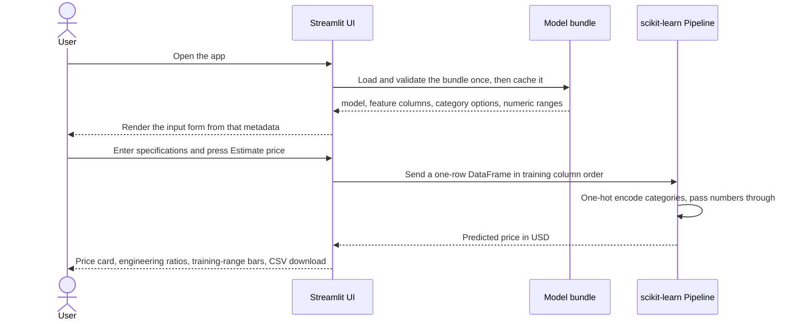
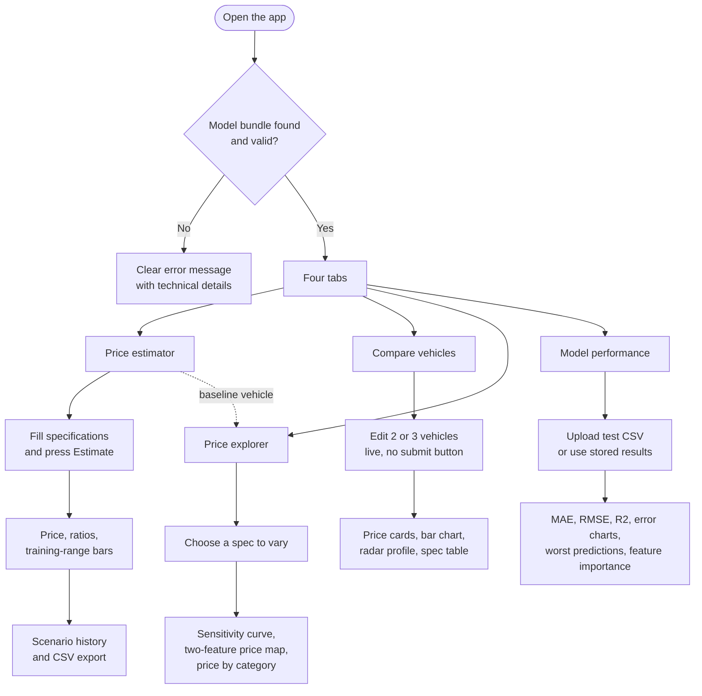

# EV Price Intelligence

**An end-to-end machine-learning project that estimates electric-vehicle prices from specifications, and an interactive analytics app for comparing vehicles, exploring what drives price, and auditing model accuracy.**


---

## Table of contents

1. [What this project does](#1-what-this-project-does)
2. [Why it matters](#2-why-it-matters)
3. [How it works (flow diagrams)](#3-how-it-works)
4. [Dataset](#4-dataset)
5. [Methodology](#5-methodology)
6. [Results](#6-results)
7. [The application](#7-the-application)
8. [How to use the app (user guide)](#8-how-to-use-the-app)
9. [Quick start](#9-quick-start)
10. [Model bundle reference](#10-model-bundle-reference)
11. [Project structure](#11-project-structure)
12. [Deployment](#12-deployment)
13. [Troubleshooting](#13-troubleshooting)
14. [Limitations and future work](#14-limitations-and-future-work)
15. [Author](#15-author)

---

## 1. What this project does

The project has two parts that work together:

| Part | File | What it does |
|---|---|---|
| **Analysis and modelling** | `EV_Market.py` | Explores the EV market dataset, makes feature decisions, trains and validates regression models, and exports the final model with its metadata. |
| **Interactive application** | `app.py` | Loads the exported model and lets anyone estimate a price, compare vehicles side by side, run what-if analysis, and review model accuracy. |

In one sentence: **you enter a vehicle's specifications and the app returns an estimated market price in US dollars, with the context needed to judge whether to trust it.**

---

## 2. Why it matters

EV manufacturers, analysts, and product planners regularly ask questions like:

- *Where should a new model be priced against competitors with similar specs?*
- *How much is an extra 10 kWh of battery or 50 hp worth in the market?*
- *Is a competitor's vehicle priced above or below what its specifications justify?*

This project turns those questions into a tool. The app reports engineering ratios (efficiency in mi/kWh, price per mile of range, price per kWh, power-to-weight) next to every estimate, and it shows where each input sits relative to the data the model has seen, so users know when an estimate is on solid ground.

---

## 3. How it works

### 3.1 End-to-end pipeline



### 3.2 Modelling decisions

The final feature set was reached by testing, not by assumption. Each branch below corresponds to an experiment in the notebook.



### 3.3 What happens when a user requests an estimate



### 3.4 Application map



---

## 4. Dataset

**File:** `ev_market_2026.csv` (one row per vehicle configuration)
**Target:** `price_usd`

Columns used in the analysis include vehicle identity (`brand`, `model`, `year`, `variant`), performance and battery (`battery_capacity_kwh`, `range_miles`, `charging_speed_kw`, `acceleration_0_60_mph`, `top_speed_mph`, `horsepower`, `torque_nm`), design and practicality (`drive_type`, `seating_capacity`, `body_type`, `cargo_volume_cubic_ft`, `weight_kg`), and safety and market information (`safety_rating`, `autopilot_level`, `country_of_origin`, `annual_sales_units`, `customer_rating`, `market_segment`, `warranty_years`).

> Place the CSV in a `data/` folder and read it with a relative path (for example `pd.read_csv("data/ev_market_2026.csv")`) so the notebook runs on any machine. If the dataset's license does not allow redistribution, link to the source instead of committing the file.

---

## 5. Methodology

### 5.1 Exploratory analysis

- Data quality checks: shape, data types, summary statistics, missing values, duplicate rows.
- Price distribution across the market.
- Average price by brand and by trim variant.
- Battery capacity versus range (scatter plot and correlation).
- Range versus customer rating, to test whether more range improves satisfaction.
- Market-segment summary: average price, range, rating, and total sales.
- Top 10 brands by annual sales.
- Country-of-origin comparison.
- Correlation of every numeric feature with price.

<p align="center">
  
  
</p>
<p align="center">
  
  
</p>

What the exploration showed: prices are right-skewed with most vehicles between roughly $40K and $110K; Lucid, Porsche, and Mercedes sit at the top on average price; range rises almost linearly with battery capacity; and customers rate longer-range vehicles higher on average.

### 5.2 Feature decisions

Each removal was tested on the same train/test split and the same Random Forest settings, so score changes come only from the features.

| Column | Decision | Evidence |
|---|---|---|
| `market_segment` | Removed | Before removal, `market_segment_Luxury` alone held about 62% of the model's feature importance and `Premium` about 17% (figure below). Segment labels line up with price bands, so the model was reading the answer from a label derived from price, which is target leakage. |
| `segment_from_price` | Removed | A helper column built from `price_usd` during the leakage check. It was accidentally picked up by a later preprocessing step, which made the app return near-identical prices for every vehicle. A leakage guard now stops training if any feature name contains "price" (see `train_model.py`). |
| `warranty_years` | Removed | With `market_segment` already gone, dropping it improved the test score (R² 0.9031 to 0.9064, MAE $5,422 to $5,224). It added noise rather than signal. |
| `torque_nm` | Removed | Torque is almost a duplicate of horsepower: the two correlate at 0.992, and their correlations with price are nearly identical (0.765 and 0.760). Removing it gave a small further gain. |

**How the score moved as features were tested**

| Feature set | MAE (USD) | R² |
|---|---|---|
| All features (includes the `market_segment` leak) | 4,654 | 0.9519 |
| Without `market_segment` | 5,422 | 0.9031 |
| Without `market_segment` and `warranty_years` | 5,224 | 0.9064 |
| **Final: also without `torque_nm`** | **5,161** | **0.9070** |

The first score looked good only because of the leak. Removing it cost accuracy, which is exactly the signature of leakage, and the final leak-free model is the honest benchmark.

<p align="center">
  <br>
  <em>Before cleanup: the market_segment labels dominate the model, which signals target leakage.</em>
</p>

> **Lesson learned.** A second price-derived column (`segment_from_price`) slipped back into a later training cell and inflated the scores (R² 0.9555 on that run). It was caught because the app returned almost the same price for every input. Every number in this README comes from the leak-free feature set.

### 5.3 Modelling

- **Preprocessing:** a `ColumnTransformer` that one-hot encodes categorical columns (`handle_unknown="ignore"`, so unseen categories do not crash predictions) and passes numeric columns through unchanged. It lives inside a scikit-learn `Pipeline`, so the app applies identical preprocessing at prediction time.
- **Split:** 80% train, 20% test, `random_state=42`.
- **Models:** Linear Regression as a transparent benchmark, and Random Forest (200 trees) as the main model.
- **Validation:** hold-out test set, 5-fold shuffled cross-validation (reporting the mean and standard deviation of R²), and a training-versus-test R² check for overfitting.
- **Interpretation:** Random Forest feature importances and permutation importance on the test set.
- **Tuning:** `RandomizedSearchCV` over tree count, depth, minimum samples per split and leaf, and feature fraction (20 candidates, 5-fold CV, scored on MAE). The tuned and baseline models are chosen between using cross-validation on the training split only, and the test set is scored once.

### 5.4 Error analysis

Aggregate scores can hide weak spots, so errors were broken down further:

- the ten largest individual errors, with vehicle details;
- mean error and MAE by brand;
- a residual plot (predicted price against error);
- MAE, RMSE, and MAPE by price range: Budget (under $35K), Mid-range ($35K to $65K), Premium ($65K to $100K), Luxury (over $100K).

---

## 6. Results

All models were evaluated on the same 20% hold-out test set (400 vehicles, `random_state=42`), using the leak-free feature set.

| Model | MAE (USD) | RMSE (USD) | R² |
|---|---|---|---|
| Linear Regression | 11,688 | 16,170 | 0.7707 |
| **Random Forest (200 trees)** | **5,161** | **10,297** | **0.9070** |

Random Forest cuts the average error by about 56% compared with Linear Regression, which shows that price depends on non-linear effects and interactions (for example brand combined with performance). It explains about 91% of the variation in price on vehicles it has not seen, with a typical error of about $5,200.

**Stability check:** 5-fold cross-validation gave R² scores of 0.909, 0.917, 0.948, 0.935, and 0.962 (mean 0.934, standard deviation 0.019), so performance is consistent across different slices of the data.

**Hyperparameter tuning:** `train_model.py` compares the baseline with a `RandomizedSearchCV` model (20 candidates, 5-fold CV) and keeps whichever has the lower cross-validated error. An earlier tuning run is not reported because its feature set contained a leaked column.

> **Which model does the app serve?** The model selected by `train_model.py`, together with its test metrics, stored in the bundle.

<p align="center">
  
  
</p>

### What drives the price

<p align="center">
  
</p>

- **Horsepower is by far the strongest driver**, with about 61% of the model's importance.
- **Brand is the second major factor** (Mercedes about 9%, Tesla about 4%, BMW about 2%, plus Audi, Porsche, Lucid, and others). Because brand is one-hot encoded, its importance is spread across many columns, so its combined influence is larger than any single bar suggests.
- **Charging speed** is the third strongest single feature (about 8%), followed by country of origin (Germany), annual sales, and driver-assist level.

### Where the model is accurate and where it struggles

Error by price band:

| Price band | Vehicles | MAE (USD) | Average % error |
|---|---|---|---|
| Budget (under $35K) | 25 | 1,847 | 6.7% |
| Mid-range ($35K to $65K) | 127 | 2,358 | 4.9% |
| Premium ($65K to $100K) | 159 | 4,713 | 5.7% |
| Luxury (over $100K) | 89 | 10,890 | 7.9% |

Dollar error grows with price, but percentage error stays in a narrow 5% to 8% band. The model is most reliable for mid-range vehicles and least reliable for luxury, where it tends to **under-predict** (mean error of +$5,877).

Error by brand (test set):

| Brand | Vehicles | MAE (USD) |
|---|---|---|
| Lucid | 3 | 84,167 |
| Fisker | 8 | 18,193 |
| Tesla | 84 | 4,604 |
| BYD | 51 | 3,585 |
| Volkswagen | 37 | 2,361 |
| GM/Chevrolet | 18 | 2,321 |

- The three largest errors are all Lucid vehicles, under-predicted by $73K to $93K, and most of the ten largest involve very high horsepower (943 to 1,000 hp).
- Errors concentrate in ultra-luxury and low-volume brands, where the training data has few examples. Brands with many records (Tesla, BYD, Volkswagen, Ford) are predicted far more accurately.
- Several of the largest errors involve vehicles with horsepower of exactly 1,000, which suggests the field may be capped in the dataset (see limitations).

---

## 7. The application

| Tab | Purpose | Highlights |
|---|---|---|
| **Price estimator** | Estimate one vehicle's price | Form built from the model's own metadata, price card, optional error range, four engineering ratios, training-range position bars, scenario history, CSV export |
| **Compare vehicles** | Put two or three configurations side by side | Live updates, price difference versus Vehicle A, bar chart, radar profile, differences-only spec table |
| **Price explorer** | Understand how specifications move price | Sensitivity curve, two-feature price heatmap, price-by-category chart |
| **Model performance** | Audit the model | MAE, RMSE, R², average % error, actual-vs-predicted, error histogram, error by price band and by group, worst predictions, feature importance |

**Design choices worth noting**

- **Linked dropdowns.** Choosing a brand limits the model list to that brand's models, and choosing a model limits the trims, so impossible combinations cannot be entered.
- **Metadata-driven UI.** Dropdown options, numeric limits, and defaults come from the model bundle, so retraining on new data updates the app without code changes.
- **Safe by default.** The bundle is validated on load, the model is cached, and errors are shown as clear messages with expandable technical details.
- **Honest about uncertainty.** Every estimate is labelled as a model output, and inputs near the edge of the training range are visible at a glance.

---

## 8. How to use the app

### Estimate a price

1. Open the **Price estimator** tab.
2. Set the vehicle's specifications in the four groups: identity, performance and battery, design and practicality, safety and market. Defaults are the typical (median) values from the training data.
3. Press **Estimate price**.
4. Read the result:
   - the **estimated price** in USD (with a typical error range if the bundle contains metrics);
   - **engineering ratios**, which help judge whether the price is reasonable for the specs;
   - **training-range bars**: a bar near either end means that input is unusual for the data, so treat the estimate with extra caution.
5. Press **Download this estimate (CSV)** to save it. Every estimate is also added to the **Scenario history** table, which can be exported or cleared.

### Compare vehicles

1. Open **Compare vehicles** and choose 2 or 3 vehicles.
2. Expand each vehicle's specifications and edit them. Results at the top update immediately.
3. Read the price cards (the change versus Vehicle A is shown on B and C), the bar chart, and the radar chart, which shows each vehicle's specification profile on a 0 to 1 scale.
4. Use **Show only differences** to focus the table on what actually changes.

### Explore what drives price

1. Set a baseline vehicle in the **Price estimator** tab (typical values are used until you change them).
2. Open **Price explorer**.
3. **Price sensitivity:** pick one specification and see how the estimate changes across its full range. The dark dot is your baseline.
4. **Two-feature price map:** pick two specifications to see price as a heatmap. The orange dot is your baseline.
5. **Price by category:** see how the estimate changes if only the brand, body style, or drivetrain changes.

> These charts change one or two inputs and hold the rest fixed, so unusual combinations (such as a brand paired with a body style it never sold) are extrapolations.

### Review model performance

1. Open **Model performance**.
2. If the bundle contains stored test results, the dashboard loads automatically. Otherwise, upload a CSV of vehicles **the model has not seen**, containing all feature columns plus the actual price, and select the price column.
3. Review the metrics, the actual-versus-predicted chart, errors by price band and by brand, and the ten largest errors.

---

## 9. Quick start

**Requirements:** Python 3.10 or newer.

```bash
# 1. Clone the repository
git clone https://github.com/<your-username>/<your-repo>.git
cd <your-repo>

# 2. (Recommended) create a virtual environment
python -m venv .venv
# Windows:  .venv\Scripts\activate
# macOS/Linux:  source .venv/bin/activate

# 3. Install dependencies
python -m pip install -r requirements.txt

# 4. Run the app
python -m streamlit run app.py
```

The app opens at `http://localhost:8501`. The file `ev_price_model.joblib` must be in the same folder as `app.py`.

**To rebuild the model from scratch:** place the dataset in `data/` and run `python train_model.py --data data/ev_market_2026.csv`. It exports a fresh `ev_price_model.joblib`, including accuracy metrics and test predictions for the dashboard.

---

## 10. Model bundle reference

The app reads a single `joblib` file containing a Python dictionary:

| Key | Required | Description |
|---|---|---|
| `model` | Yes | A fitted scikit-learn estimator or pipeline with a `predict()` method |
| `feature_columns` | Yes | List of input column names, in the order used for training |
| `categorical_options` | Recommended | `{column: [allowed values]}` used to build dropdowns |
| `numeric_ranges` | Recommended | `{column: {"min": ..., "max": ..., "median": ...}}` used for input limits and range bars |
| `numeric_defaults` | Recommended | `{column: default value}` used as the starting value |
| `hierarchy` | Optional | `{"columns": ["brand", "model", "variant"], "tree": {brand: {model: [variants]}}}` makes the dropdowns show only the models and trims that belong to the selected brand |
| `metrics` | Optional | `{"mae": ..., "rmse": ..., "r2": ..., "n_train": ...}` enables the error range on estimates and the overview cards |
| `evaluation` | Optional | `{"y_true": [...], "y_pred": [...]}` populates the performance dashboard on first load |
| `feature_importance` | Optional | `{feature: score}` overrides automatic importance detection |

**Export a complete bundle** by running the training script, which builds the model, checks for leakage, and writes every key above:

```bash
python train_model.py --data data/ev_market_2026.csv
```

---

## 11. Project structure

```text
ev-price-intelligence/
├── app.py                    # Streamlit application (4 tabs)
├── EV_Market.py              # Exploratory analysis and experiments
├── train_model.py            # Reproducible, leak-free training and bundle export
├── ev_price_model.joblib     # Trained model bundle used by the app
├── requirements.txt          # Python dependencies
├── .streamlit/
│   └── config.toml           # Light theme configuration
├── data/
│   └── ev_market_2026.csv    # Dataset (check its license before committing)
├── docs/
│   └── images/               # Charts used in this README
└── README.md
```

**Tech stack:** Python, pandas, NumPy, scikit-learn, Plotly, Streamlit, joblib.

---

## 12. Deployment

The app deploys free on [Streamlit Community Cloud](https://streamlit.io/cloud):

1. Push the project to a public GitHub repository, including `app.py`, `ev_price_model.joblib`, `requirements.txt`, and `.streamlit/config.toml`.
2. Sign in to Streamlit Community Cloud, choose **New app**, and select the repository and `app.py`.
3. Deploy, then add the public link at the top of this README.

**Important:** pin the scikit-learn version in `requirements.txt` to the one you trained with (for example `scikit-learn==1.5.2`). A mismatch is the most common cause of model-loading errors after deployment.

---

## 13. Troubleshooting

| Problem | Likely cause and fix |
|---|---|
| `ModuleNotFoundError: No module named 'plotly'` | Dependencies are not installed in the Python you are running. Use `python -m pip install -r requirements.txt`, then `python -m streamlit run app.py`. |
| `Model file not found` | `ev_price_model.joblib` must sit in the same folder as `app.py` (or in the folder you launch from). |
| Model fails to load after upgrading a library | The model was saved with a different scikit-learn version. Install the training version, or retrain and re-export. |
| `NameError: name '__file__' is not defined` | The app was run from a notebook cell. Save it as `app.py` and run it with Streamlit from a terminal. |
| Every estimate is almost the same price | A feature derived from the price is leaking into the model. The app shows a warning when a feature name contains "price". Retrain with `train_model.py`, which removes leaking columns. |
| Estimate fails with an unknown category | The dropdown values come from the bundle. Regenerate the bundle so `categorical_options` matches your data. |
| Performance tab says "No test data yet" | Upload a test CSV, or export the bundle with `train_model.py`, which includes `evaluation` and `metrics`. |

---

## 14. Limitations and future work

**Limitations**

- Estimates are model outputs based on historical patterns, not dealer quotes or guaranteed market prices.
- The model does not account for incentives, regional taxes, options packages, new technology, or market changes after the data was collected.
- Accuracy drops for configurations far from the training data. The training-range bars exist to flag this.
- Accuracy is lowest for ultra-luxury and low-volume brands (for example Lucid and Fisker), because the training data holds few examples of them.
- Several high-error vehicles show horsepower of exactly 1,000, which suggests the field may be capped. Horsepower carries about 61% of the model's importance, so a capped value limits what the model can learn.

**Future work**

- Link country of origin to the selected brand, and body style to the selected model.
- Compare Gradient Boosting, XGBoost, or LightGBM against Random Forest.
- Add prediction intervals (for example with quantile regression forests) instead of a single average error.
- Add SHAP explanations to show why a specific vehicle receives its price.
- Track price over model years to analyse depreciation and market trends.
- Add automated tests and a CI check that the bundle and app stay compatible.

---

## 15. Author

**Aditya Mishra**
Data Analytics and Machine Learning

[LinkedIn](https://www.linkedin.com/in/adityaakmmishra) · [GitHub](https://github.com/AdityaMishra99) · adi.mishra.akm@gmail.com

_Built with Python, scikit-learn, Plotly, and Streamlit._
